  

<!--
  Every card above is generated by render_cards.py and refreshed daily by
  .github/workflows/profile-cards.yml — do not edit cards/ by hand.
  Final frame for screenshots: STATIC=1 python3 render_cards.py
-->
